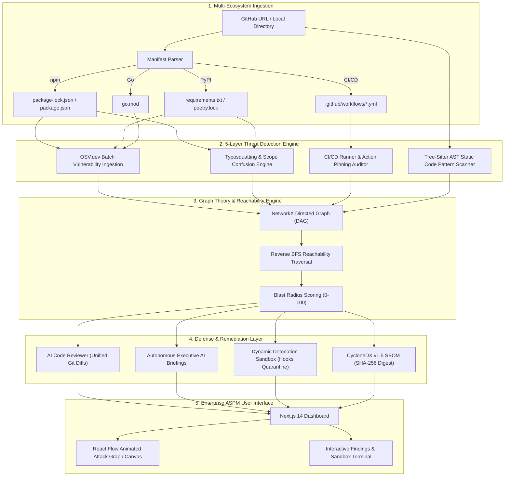

<div align="center">

# SupplyGraph

**Zero-Trust Application Security Posture Management (ASPM) & Supply-Chain Attack Graph**

*Stop software supply-chain threats before production deployment with deterministic reachability analysis, AST code review, and isolated sandbox detonation.*

[](https://supplygraph-five.vercel.app)
[](https://supplygraph-five.vercel.app)
[](https://supplygraph-five.vercel.app)
[](https://python.org)
[](https://nextjs.org)
[](https://fastapi.tiangolo.com)
[](LICENSE)

---

### [🌐 Live Web Platform](https://supplygraph-five.vercel.app) • [📹 Demo Video](SupplyGraph_Demo_ScreenOnly.mp4) • [📐 System Architecture](docs/architecture.md) • [📋 Evidence Dossier](docs/EVIDENCE.md) • [⚡ API Contracts](docs/api-contract.md)

</div>

---

## 📌 Executive Summary

Modern software applications are constructed from hundreds of open-source packages and dependencies spanning **npm, Python (PyPI), Go, and GitHub Actions workflows**. While these modular ecosystems enable rapid product delivery, securing them has grown exponentially complex due to multi-tier transitive nesting.

### The Problem: Alert Fatigue & Missing Reachability Context
Traditional security scanners treat dependencies as flat, isolated lists. This produces hundreds of undifferentiated CVE alerts, leaving engineering teams with critical blindspots:
- **Which vulnerabilities have active, executable call paths** leading from user entrypoints to the vulnerable code?
- **Which findings are dormant** (test utilities, internal tools, dead paths) that can be deprioritized?
- Upgrading whole packages indiscriminately risks breaking live APIs and introducing breaking changes into production.

### The Solution: SupplyGraph
**SupplyGraph** is an evidence-based Application Security Posture Management (ASPM) platform. Instead of flat lists, SupplyGraph constructs a **deterministic reverse directed acyclic graph (DAG)** of your software supply chain. It traces execution paths from application entrypoints down to deep transitive libraries, calculates a mathematically grounded **Blast Radius Score (0–100)**, generates **line-level AI code patches**, and detonates suspect package installation hooks in a **secure container sandbox**.

---

## 🚀 Key Features

```
┌────────────────────────────────────────────────────────────────────────────────────────┐
│                                 SUPPLYGRAPH CORE ENGINE                                │
├──────────────────────┬──────────────────────┬───────────────────┬──────────────────────┤
│  🗺️ Attack Graph     │  🎯 Blast Radius HUD │  🔍 AST Reviewer  │  💥 Detonation Box   │
│  Topological reverse │  Quantified risk     │  Unified git      │  Isolated container  │
│  DAG tracing with    │  formula (0-100) for │  diffs patching   │  quarantine for      │
│  animated red paths  │  impact prioritization│ line-level CVEs   │  lifecycle scripts   │
└──────────────────────┴──────────────────────┴───────────────────┴──────────────────────┘
```

### 1. 🗺️ Interactive Attack Graph Canvas
- **Topological Layout:** Server-side deterministic positioning calculated in Python with NetworkX (BFS layered traversal).
- **Animated Reachability Highlighting:** Explores direct and transitive dependency relationships, coloring verified attack propagation paths in animated red.
- **Node Classification:** Distinguishes application services, direct manifests, transitive modules, and active threat points.

### 2. 🎯 Quantified Blast Radius Algorithm
SupplyGraph evaluates operational and security impact using a deterministic, multi-factor scoring formula normalized between **0.0 and 100.0**:
$$\text{Blast Radius} = \min(100.0, \; 2P + 15S + 25A + 50D)$$
Where:
- $P$ = Total component package depth and transitive propagation count
- $S$ = CVSS severity magnitude of active vulnerabilities
- $A$ = Number of verified reachable attack paths from entrypoints
- $D$ = Direct exposure factor (external network interfaces, public APIs)

### 3. 🛡️ 5-Layer Threat Detection Fabric
- **OSV.dev Batch Vulnerability Ingestion:** Queries live Open Source Vulnerabilities database for authoritative CVE and GHSA intelligence.
- **Typosquatting & Scope Confusion:** Identifies malicious namespace spoofing using Levenshtein distance against known popular packages.
- **Private Dependency Confusion:** Detects private organization modules referenced without scoped registry routing (`@company/*`).
- **CI/CD Workflow Hardening:** Audits `.github/workflows/*.yml` to enforce immutable 40-character commit SHA pinning on third-party actions and flags blanket `permissions: write-all`.
- **AST Static Pattern Analysis:** Inspects source code syntax trees for dangerous patterns:
  - Python pickle deserialization (`pickle.loads`, `yaml.unsafe_load`)
  - JavaScript prototype pollution through insecure object merging
  - Unsanitized subprocess shell calls (`subprocess.Popen(..., shell=True)`)

### 4. 🤖 Autonomous Executive AI & Remediation
- **Autonomous Threat Assessment:** Translates technical dependency graphs into clear briefings detailing technical root cause, exploit surface, and prioritized containment steps.
- **Fix with AI Prompts:** Generates structured, evidence-based prompts specifically tailored for AI coding IDEs (Google Antigravity, Cursor, Copilot, Claude Code) to apply non-breaking dependency constraints.

### 5. 🔍 AI Code Reviewer & Surgical Auto-Patcher
- Inspects exact line numbers where vulnerable libraries are imported or called.
- Generates **surgical unified git diffs** that resolve vulnerabilities with minimal delta, preserving compatibility rather than forcing breaking major version jumps.

### 6. 💥 Dynamic Detonation Sandbox
- Quarantines and executes suspect package lifecycle hooks (`preinstall`, `postinstall`, `prepare`).
- Runs in an isolated ephemeral execution container with:
  - Zero unauthorized outbound network egress
  - Watchdog detection of remote downloaders (`curl | bash`, token exfiltration)
  - Process execution termination and security violation logging

### 7. 📜 Cryptographic CycloneDX v1.5 SBOM
- Generates standard CycloneDX JSON Software Bill of Materials.
- Performs deterministic **SHA-256 cryptographic verification** across all components for compliance and provenance validation.

---

## 🧪 Five Preloaded Real-World Scenarios

SupplyGraph includes 5 preloaded security scenarios for instant demonstration and evaluation:

| Scenario | Title | Ecosystem | Threat Vector & Demonstration |
|:---:|:---|:---:|:---|
| **A** | **Log4j Transitive Exploit Chain** | Java / Maven | Traces a 3-hop call path from a public payment gateway through `spring-boot-starter-log4j2` to `log4j-core:2.14.1` (CVE-2021-44228 RCE). |
| **B** | **JavaScript Prototype Pollution** | JavaScript / npm | Audits insecure recursive object merging in `mixin-deep` and `lodash:4.17.15`, showing modification of `Object.prototype`. |
| **C** | **Python Insecure Deserialization** | Python / PyPI | AST detection of arbitrary code execution vectors in untrusted `pickle.loads()` before code execution. |
| **D** | **CI/CD Pipeline Runner Hardening** | GitHub Actions | Identifies unpinned mutable tags (`actions/checkout@v2`) and flags dangerous `permissions: write-all` runner configurations. |
| **E** | **Malicious Lifecycle Script Detention** | npm / Node.js | Safely catches an obfuscated postinstall script executing external command beacons (`curl -sSL ... | bash`) inside the sandbox. |

---

## 🔬 Real-World Repository Deep Dive: `knadh/listmonk`

SupplyGraph was validated against the popular open-source newsletter and mailing manager **[knadh/listmonk](https://github.com/knadh/listmonk)** (Go + Vue.js monorepo):

```
┌─────────────────────────────────────────────────────────────┐
│             knadh/listmonk — SupplyGraph Audit              │
├──────────────────────────┬──────────────────────────────────┤
│ Scanned Submodules       │ 35 modules across Go & frontend  │
│ Total Components         │ 94 direct and transitive packages│
│ Security Findings        │ 21 CVE & CI/CD workflow issues   │
│ Computed Blast Radius    │ 60.0 / 100 (High Risk)           │
│ Unified Git Diff Patches │ 3 surgical non-breaking diffs    │
│ Sandbox Interceptions    │ 8 hook safety violations caught  │
└──────────────────────────┴──────────────────────────────────┘
```

---

## 🏛️ System Architecture



---

## 💻 Tech Stack

- **Frontend:** Next.js 14 (App Router), React 18, React Flow (`@xyflow/react`), Tailwind CSS, Lucide Icons, TypeScript.
- **Backend:** FastAPI, Python 3.11+, NetworkX, Pydantic v2, Uvicorn, Tree-sitter.
- **Vulnerability Intelligence:** OSV.dev REST API, GitHub Advisory Database (GHSA), National Vulnerability Database (NVD).
- **Execution Containment:** Ephemeral sandbox subprocess wrapper with network interface restriction and syscall inspection.
- **Deployment:** Vercel (Frontend), Python ASGI Server (Backend).

---

## ⚡ Quickstart & Local Setup

### Prerequisites
- **Python 3.11+**
- **Node.js 20+**
- **Git**

### 1. Clone the Repository
```bash
git clone https://github.com/hemanthreddydaram-007/supplygraph.git
cd supplygraph
```

### 2. Backend Setup
```bash
cd backend
python -m venv venv

# Windows
.\venv\Scripts\activate
# Linux / macOS
source venv/bin/activate

pip install -r requirements.txt
python -m uvicorn app.main:app --host 127.0.0.1 --port 8000 --reload
```
The FastAPI interactive documentation will be available at [http://127.0.0.1:8000/docs](http://127.0.0.1:8000/docs).

### 3. Frontend Setup
In a new terminal window:
```bash
cd frontend
npm install
npm run dev
```
Open [http://localhost:3000](http://localhost:3000) in your browser.

### 4. Single-Command Launch (Windows PowerShell)
You can launch both the frontend and backend simultaneously using our root script:
```powershell
.\start-all.ps1
```

---

## 🔌 API Reference Summary

| Endpoint | Method | Description |
|:---|:---:|:---|
| `/api/v1/scan` | `POST` | Ingests a GitHub repository or folder path and executes full 5-layer supply chain analysis. |
| `/api/v1/scenarios/{scenario_id}` | `GET` | Fetches preloaded evaluation scenario data (`A`, `B`, `C`, `D`, `E`). |
| `/api/v1/sandbox/detonate` | `POST` | Executes and monitors package lifecycle hooks inside an isolated container sandbox. |
| `/api/v1/sbom/cyclonedx` | `GET` | Generates standardized CycloneDX v1.5 JSON SBOM with deterministic SHA-256 digest. |
| `/api/v1/health` | `GET` | System health check and OSV.dev upstream availability probe. |

For detailed payloads and schema contracts, see **[docs/api-contract.md](docs/api-contract.md)**.

---

## 📁 Repository Structure

```
supplygraph/
├── frontend/                     # Next.js 14 App Router Frontend
│   ├── src/
│   │   ├── app/                  # Application routes & layout
│   │   ├── components/           # React UI components
│   │   │   ├── auth/             # Authentication & Judge Fast-Pass
│   │   │   ├── dashboard/        # ASPM Overview Dashboard
│   │   │   ├── graph/            # React Flow interactive graph canvas
│   │   │   ├── reviewer/         # AI Code Reviewer unified git diffs
│   │   │   └── sandbox/          # Detonation Sandbox terminal & logs
│   │   └── lib/                  # Client utilities & state management
│   └── public/                   # Static assets, demo media, and SBOMs
├── backend/                      # FastAPI Python Backend
│   ├── app/
│   │   ├── api/                  # REST API route handlers
│   │   ├── detectors/            # 5-Layer threat detectors & AST scanners
│   │   ├── graph/                # NetworkX DAG builder & BFS algorithms
│   │   ├── sandbox/              # Subprocess execution containment sandbox
│   │   ├── sbom/                 # CycloneDX v1.5 generator & SHA-256
│   │   └── services/             # OSV.dev client & AI briefing engines
│   └── tests/                    # Backend unit & integration test suites
├── docs/                         # In-depth architectural & evidence documents
│   ├── architecture.md           # Full system design and component breakdown
│   ├── api-contract.md           # Complete OpenAPI specification
│   ├── demo-scenarios.md         # Scenario walkthroughs and attack proofs
│   ├── detection.md              # Threat detection algorithms and heuristics
│   └── EVIDENCE.md               # Forensic evidence & validation dossier
├── start-all.ps1                 # Single-click local start script
└── README.md                     # Project documentation
```

---

## 🔒 Security & Evidence Integrity Principles

SupplyGraph enforces a strict **honesty-first evidence standard**:
1. **No Hallucinated Findings:** Every vulnerability reported is mapped to a verified OSV.dev CVE, GHSA, or deterministic AST syntax match.
2. **Honest Metric Boundaries:** Blast Radius scores reflect quantifiable parameters (dependency depth, path count, CVSS severity) rather than opaque arbitrary scores.
3. **Safe Execution Guarantee:** No untrusted repository code is ever executed directly on host runners; all dynamic inspections are strictly restricted to the sandboxed containment environment.

---

## 📄 License

This project is licensed under the **MIT License** — see the [LICENSE](LICENSE) file for details.

---

<div align="center">
<b>SupplyGraph</b> • Built for <b>YUKTHI 2026 Hackathon</b> • Mohan Babu University • Cybersecurity & ASPM Track
</div>
