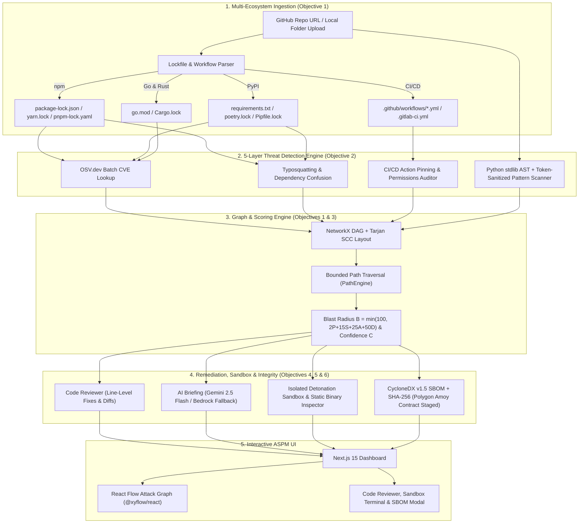

<div align="center">

# SupplyGraph

**Zero-Trust Software Supply-Chain Attack Graph, AI Code Reviewer & Cryptographic SBOM Platform**

*Stop software supply-chain threats before production deployment with deterministic NetworkX reachability graphs, Python AST & token-sanitized static code review, isolated behavioral sandbox detonation, and CycloneDX SHA-256 posture attestation.*

[](https://supplygraph-five.vercel.app)
[](https://supplygraph-five.vercel.app)
[](https://supplygraph-five.vercel.app)
[](https://python.org)
[](https://nextjs.org)
[](https://fastapi.tiangolo.com)
[](LICENSE)

---

### [🌐 Live Platform](https://supplygraph-five.vercel.app) • [🎯 Problem Statement Alignment](docs/PROBLEM_STATEMENT_ALIGNMENT.md) • [📐 Architecture](docs/architecture.md) • [📋 Evidence Dossier](docs/EVIDENCE.md) • [⚡ API Contracts](docs/api-contract.md) • [🧪 Demo Scenarios](docs/demo-scenarios.md)

</div>

---

## 🌐 Live Platform — Zero Setup Required

<div align="center">

### 👉 **[https://supplygraph-five.vercel.app](https://supplygraph-five.vercel.app)**

*Deployed Next.js Frontend (Vercel) + FastAPI Security Engine (Render) • Instant direct dashboard access (no login gate)*

</div>

- **Direct Access:** Open [supplygraph-five.vercel.app](https://supplygraph-five.vercel.app) and click **Get Started — Scan Project** or launch any of the 5 preloaded scenarios (`A`–`E`) directly.
- **Dual Ingestion:** Scan any public **GitHub URL** or upload a **local project folder** directly from the browser.
- **Interactive API Docs:** OpenAPI/Swagger UI exposed by the FastAPI backend at `/api/docs`.

---

## 🚨 Root Challenge

> **The core problem SupplyGraph targets:**
> *Modern applications and AI-assisted codebases pull hundreds of transitive open-source dependencies across npm, PyPI, Go, Cargo, and GitHub Actions—yet traditional security tools emit flat, disconnected CVE alerts without showing whether a flaw is structurally reachable to production assets, whether AI-generated boilerplate contains insecure code patterns, whether package install hooks execute malicious payloads, or whether the resulting SBOM audit trail is tamper-evident.*

Software supply chains break down across **four interconnected root failure modes**:

1. **Transitive Dependency Blindness & Alert Fatigue:** Flat dependency scanners list CVEs without multi-hop call-path reachability, leaving teams unable to separate reachable threats from dormant packages.
2. **AI-Generated Code & Hallucinated Package Risks:** Developers using AI coding assistants often ship insecure boilerplate (`eval()`, `exec()`, `pickle.loads()`, `subprocess(..., shell=True)`, prototype pollution, XSS sinks, hardcoded tokens) or pull typosquatted / dependency-confused package names.
3. **Install-Time & CI/CD Execution Blindspots:** Compromised `preinstall`/`postinstall` lifecycle scripts, compiled binaries, and misconfigured CI/CD workflows (unpinned third-party actions, `permissions: write-all`, `curl | bash`) execute outside static manifest checks.
4. **Mutable Audit & SBOM Trails:** Standard JSON SBOMs lack deterministic cryptographic integrity fingerprints and tamper-evident attestation for downstream verification.

---

## 👥 User Needs

SupplyGraph addresses the concrete workflows of three primary user personas:

### 👨‍💻 Need 1 — The Developer / Student Builder
> *"I scaffolded my project with AI and installed dozens of packages. Which alerts actually threaten my app, and how do I patch them without breaking my API?"*

| User Need | How SupplyGraph Solves It |
|-----------|---------------------------|
| Know which transitive CVEs actually connect to services/APIs | NetworkX Reverse DAG & bounded path traversal traces origin packages to downstream assets (`PathEngine`) |
| Detect insecure patterns & hardcoded secrets in source code | Python stdlib `ast.parse()` + token-sanitized regex engine (`ASTAnalyzer` & `CodeReviewerService`) |
| Catch fake, typosquatted, or hijacked package names | Levenshtein similarity ($\ge 0.85$) typosquatting detector + scoped private-namespace confusion detector |
| Fix vulnerabilities with minimal, non-breaking changes | Line-level code review diffs (`CodeReviewItem`) + Gemini 2.5 Flash / Bedrock Claude 3.5 remediation |
| Audit GitHub Actions & GitLab CI pipelines | YAML workflow auditor flagging unpinned action tags, script injection, and `write-all` permissions |

### 🛡️ Need 2 — The Security Reviewer / Hackathon Evaluator
> *"I need to inspect a project's attack surface quickly, verify that findings are backed by real evidence, and test suspicious install hooks safely."*

| User Need | How SupplyGraph Solves It |
|-----------|---------------------------|
| Visual attack-surface comprehension in seconds | Interactive React Flow (`@xyflow/react`) DAG canvas highlighting attack propagation paths |
| Quantitative triage priority instead of vague severity tags | Deterministic Blast-Radius formula $B = \min(100, 2P + 15S + 25A + 50D)$ and Confidence Index $C = 1 - \prod(1 - w_i r_i)$ |
| Verifiable, non-hallucinated findings | Strict evidence classification (`FACT`, `HEURISTIC`, `SIMULATED`) backed by OSV.dev advisories |
| Reproducible testing without setup | 5 deterministic preloaded demo scenarios (`A`–`E`) + 188 automated pytest tests |
| Safe inspection of dangerous install scripts & binaries | Dual-mode sandbox (`--network none`, 512 MB RAM, 10s watchdog in Docker; sanitized restricted subprocess fallback) + static PE/ELF/WASM string extraction |

### 🏢 Need 3 — The DevSecOps / Compliance Team
> *"We need standardized SBOM artifacts, cryptographic integrity fingerprints, and delta posture tracking across releases."*

| User Need | How SupplyGraph Solves It |
|-----------|---------------------------|
| Standardized compliance SBOM for every scan | CycloneDX v1.5 JSON SBOM generated via `SBOMEngine` (embedded in `/scan` and served at `GET /api/v1/sbom/cyclonedx`) |
| Cryptographic tamper detection & blockchain readiness | Deterministic SHA-256 SBOM digest + composite posture fingerprint + staged Polygon Amoy smart contract (`contracts/SupplyGraphAttestation.sol`) |
| Track regressions between two scans or commits | `POST /api/v1/compare` computes dependency, finding, confidence, and Blast-Radius deltas |
| Scan local/private codebases without pushing to GitHub | `POST /api/v1/analyze/folder` accepts browser-uploaded folder trees |

---

## 🎯 Core Objectives

SupplyGraph delivers **six verifiable engineering objectives**:

1. **Objective 1 — Multi-Ecosystem Supply-Chain Attack Graph & Reachability:**
   Ingests `package-lock.json`, `yarn.lock`, `pnpm-lock.yaml`, `package.json`, `requirements.txt`, `poetry.lock`, `Pipfile.lock`, `go.mod`, `Cargo.lock`, `Cargo.toml`, and CI/CD YAML workflows into canonical PURLs (`pkg:...`), condenses dependency cycles via Tarjan SCC, and builds a deterministic NetworkX DAG with bounded reverse-reachability paths.
2. **Objective 2 — 5-Layer Threat Detection Engine:**
   Combines (1) **OSV.dev** batch CVE intelligence with SemVer matching, (2) **Typosquatting** heuristics ($\ge 0.85$ similarity), (3) **Dependency Confusion** detection, (4) **Static AST & Token-Sanitized Code Analysis**, and (5) **CI/CD Workflow Security Auditing** (plus historic supply-chain attack matching).
3. **Objective 3 — Closed-Form Heuristic Risk & Confidence Scoring:**
   - **Blast Radius:** $B = \min(100, 2P + 15S + 25A + 50D)$ at scan summary level, where $P$ = affected packages (`package_count`), $S$ = exposed services (`service_count`), $A$ = exposed APIs (`api_count`), and $D$ = production deployments (`production_deployment_count`).
   - **Confidence Index:** $C = 1 - \prod_{i=1}^{n}(1 - w_i \cdot r_i)$ combining evidence weight $w_i$ and source reliability $r_i$ (with synthetic discount applied to simulated signals).
4. **Objective 4 — Isolated Lifecycle Hook & Artifact Sandbox:**
   Detonates untrusted `preinstall`/`install`/`postinstall` hooks and test scripts inside a dual-mode sandbox (Docker `--network none`, `--memory=512m`, `--cpus=1.0`, 10s watchdog; restricted sanitized subprocess fallback stripping `AWS_*`/`GITHUB_*`/`DATABASE_*` credentials and blocking `..` path traversal) plus static PE/ELF/WASM binary inspection.
5. **Objective 5 — Line-Level Code Review & AI Remediation:**
   Tier 1 deterministic Python `ast.parse()` + token-sanitized JS/TS/Go/Rust pattern scanner returns exact `file_path`, `line_number`, `buggy_code`, and `corrected_code` items; Tier 2 executive briefings and remediation context use **Google Gemini 2.5 Flash** with **AWS Bedrock (Claude 3.5 Sonnet)** and deterministic summary fallbacks.
6. **Objective 6 — Cryptographic SBOM Integrity & Blockchain Attestation:**
   Produces CycloneDX v1.5 JSON SBOMs with deterministic SHA-256 digests (`compute_sbom_sha256`) and posture fingerprints (`compute_merkle_root`), backed by a Solidity smart contract (`contracts/SupplyGraphAttestation.sol`) and deployment scripts (`scripts/deploy_amoy.py`, `scripts/verify_attestation.py`) staged for **Polygon Amoy Testnet (Chain ID: 80002)**. *(Honestly labeled as deployment staged/pending until broadcast with testnet POL.)*

---

## ⚙️ System Architecture & 5-Layer Pipeline



---

## 🧪 5 Preloaded Deterministic Scenarios

Every scenario is deterministic and independently testable from the dashboard or `POST /api/v1/analyze/demo`:

| Scenario | Title (JSON Spec / UI) | Target Packages / Files | Root Challenge Demonstrated |
|:--------:|:------------------------|:------------------------|:----------------------------|
| **A** | Vulnerable Transitive Dependency *(Transitive CVE)* | `lodash@4.17.20` → `mixin-deep@1.3.1` (`GHSA-4xc9-xhrj-v574`) | Transitive CVE reachability & non-breaking lockfile override |
| **B** | Typosquatting *(Dependency Confusion)* | `requets` vs `requests` (`reqeusts`) | Hallucinated / typosquatted dependencies (similarity $\ge 0.85$) |
| **C** | Compromised Update *(Malicious Post-Install)* | `data-parser@1.2.0 → 1.3.0` + lifecycle hook | Obfuscated update AST signals & clearly labeled `SIMULATED` runtime / hook detonation |
| **D** | Multi-Level Supply-Chain Propagation *(Deep Chain)* | `malicious-logger@0.9.1` → `pkg-c` → `pkg-b` → `pkg-a` → `app` → Service → API → Prod | 4-hop propagation & Blast-Radius scoring (`B = 94` in scenario fixture) |
| **E** | CI/CD Risk *(CI/CD Workflow Leak)* | `.github/workflows/deploy.yml` (`curl \| bash`, `write-all`, unpinned action) | CI/CD runner hardening & least-privilege YAML patches |

---

## 📊 Verified Benchmarks & Test Evidence

Full reproducible methodology and artifacts live in **[docs/EVIDENCE.md](docs/EVIDENCE.md)** and **[evidence/benchmark-summary.md](evidence/benchmark-summary.md)**:

- **Automated Backend Tests:** `pytest tests/` → **188 passed, 0 failed** (full integration + unit suite).
- **Wasmtime Worked Math Example (`bytecodealliance/wasmtime`):** 94 package PURLs, 16 findings; $P=16, S=1, A=0, D=0 \implies B = 2(16) + 15(1) = \mathbf{47/100}$, $C = \mathbf{0.88}$.
- **Axios Static Rule Triage (`axios/axios`):** 60 candidate findings evaluated against labeled ground truth → 56 True Positives, 4 False Positives (**93.3% precision**; recall unmeasured); median scan latency $p50 = 14.2\text{ ms/file}$, $p95 = 38.0\text{ ms/file}$.
- **Next.js Graph Scaling (`vercel/next.js`):** 500 package components → 633 DAG nodes, 891 edges (1.80s build, 142.4 MB peak RAM).

---

## 🔌 API Reference Summary

Full OpenAPI documentation is available at `/api/docs` on the FastAPI backend (see **[docs/api-contract.md](docs/api-contract.md)**):

| Endpoint | Method | Purpose |
|:---------|:------:|:--------|
| `/api/v1/scan` | `POST` | Canonical entry point — executes the full 5-layer analysis pipeline (alias for `/api/v1/analyze`) |
| `/api/v1/analyze` | `POST` | Primary GitHub repository analysis endpoint |
| `/api/v1/analyze/folder` | `POST` | Analyzes uploaded local project directories offline |
| `/api/v1/analyze/demo` | `POST` | Loads deterministic evaluation scenarios (`A`–`E`) |
| `/api/v1/sandbox/detonate` | `POST` | Detonates package lifecycle hooks in the isolated sandbox (alias for `/api/v1/execute/sandbox` in `detonate` mode) |
| `/api/v1/execute/sandbox` | `POST` | Runs `detonate`, `test`, or `auto` sandbox execution / static binary inspection |
| `/api/v1/sbom/cyclonedx` | `GET` | Generates CycloneDX v1.5 JSON SBOM for `?github_url=...` |
| `/api/v1/review/code` | `POST` | Reviews an individual code snippet with line-level fix suggestions |
| `/api/v1/review/repository` | `POST` | Scans repository source files and returns `CodeReviewItem[]` + Markdown report |
| `/api/v1/compare` | `POST` | Computes dependency, finding, confidence, and Blast-Radius deltas between two scans |
| `/api/v1/health` | `GET` | System health check and version status |

---

## 💻 Tech Stack

- **Frontend:** Next.js 15 (App Router), React 18, `@xyflow/react` (React Flow), Recharts, Tailwind CSS, Lucide Icons, TypeScript
- **Backend:** FastAPI, Python 3.11+, NetworkX 3.3, Pydantic v2, Uvicorn, HTTPX
- **Static Analysis:** Python stdlib `ast.parse()` (`ASTVisitor`) + Token-Sanitized Pattern Engine (JS/TS/Go/Rust) + YAML CI/CD Analyzer
- **Vulnerability Intelligence:** OSV.dev REST API (`api.osv.dev/v1`)
- **AI Triage Layer:** Google Gemini 2.5 Flash (`google-generativeai`) + AWS Bedrock Claude 3.5 Sonnet fallback + deterministic fallback
- **Sandbox & Binary Analysis:** Docker (`--network none`, `--memory=512m`, `--cpus=1.0`, 10s watchdog) with sanitized subprocess fallback + static PE/ELF/WASM inspection
- **Standards & Blockchain:** CycloneDX v1.5 JSON SBOM (`cyclonedx-python-lib`), SHA-256 digests, Solidity contract (`contracts/SupplyGraphAttestation.sol`) staged for Polygon Amoy Testnet

---

## 📁 Repository Structure

```
supplygraph/
├── frontend/                     # Next.js 15 App Router Frontend (Vercel)
│   └── src/
│       ├── app/                  # Main workspace & routes
│       ├── components/
│       │   ├── dashboard/        # Overview Dashboard
│       │   ├── graph/            # React Flow attack graph canvas
│       │   ├── reviewer/         # Code Reviewer panel & diffs
│       │   └── sandbox/          # Detonation Sandbox terminal & logs
│       └── lib/                  # API client & remediation prompt generator
├── backend/                      # FastAPI Python Backend (Render)
│   ├── app/
│   │   ├── api/                  # REST API route handlers (/scan, /analyze, /sandbox, /sbom)
│   │   ├── detectors/            # AST, CI/CD, Typosquatting, Confusion & Historic detectors
│   │   ├── engines/              # GraphEngine, PathEngine, Confidence & Containment engines
│   │   ├── execution/            # SecureSandboxRunner, DetonationService & ExecutionRouter
│   │   ├── graph/                # Tarjan SCC layout & schema
│   │   └── services/             # AnalysisService, OSVClient, SBOMEngine, CodeReviewer, GeminiService
│   └── tests/                    # 188 unit & integration tests
├── contracts/                    # Solidity attestation smart contract (Polygon Amoy staged)
├── scripts/                      # Amoy deployment & attestation verification scripts
├── evidence/                     # Benchmark telemetry, claim audit & implementation inventory
├── docs/                         # Architecture, API contract, EVIDENCE.md & PROBLEM_STATEMENT_ALIGNMENT.md
└── README.md
```

---

## 🔒 Honesty-First Evidence Standards

1. **Verifiable Evidence Only:** Every vulnerability finding maps to an OSV.dev advisory or explicit AST/pattern match with `FACT`, `HEURISTIC`, or `SIMULATED` classification.
2. **Calibrated Precision & Explicit Limitations:** Heuristic confidence and Blast-Radius scores are explicitly labeled as heuristic estimates—not probabilities of compromise—and static precision (`93.3%` on Axios triage) is reported without claiming zero false positives.
3. **Clear Sandbox & Blockchain Boundaries:** Dual-mode sandbox limitations (Docker vs. restricted subprocess fallback) and staged Polygon Amoy contract status (`Deployment Pending`) are transparently documented.

---

## 📄 License

MIT License — see the [LICENSE](LICENSE) file for details.

---

<div align="center">
<b>SupplyGraph</b> • Built for <b>YUKTHI 2026 Hackathon</b> • Mohan Babu University • Blockchain &amp; Cybersecurity Track
</div>
